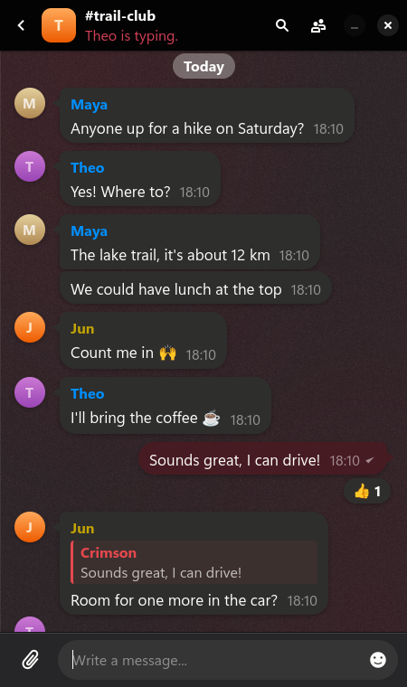

  

<h1 align="center">Crimson Chat</h1>

An <a href="https://ircv3.net">IRCv3</a> client for Linux with replies, reactions, typing indicators and synced history. 
Comes with a bouncer that keeps you online while away. 
Old protocol, new manners.

  
  
  

  <a href="https://github.com/Crimson-Org/crimson-chat/releases/latest"><b>Download Here!</b></a>

  

## Why

Crimson Chat brings IRC history, replies, reactions and read markers into a modern messenger.\
The bouncer keeps your networks connected even when your computer is off.

## About

### A messenger layout

Rooms and private chats sit in one list, newest first, and messages group into bubbles.\
The first start helps you add a server and suggests networks with good IRCv3 support.

### Modern IRC

Replies, reactions, typing indicators and read markers that follow you between devices.\
Avatars and names come from the server, links show previews, and pasting or dropping files shares them.\
Search finds messages in a room.

### Rooms in plain words

Room changes read as sentences, like "Alice made Bob a moderator".\
Moderators manage room settings, bans and invites from the room's page.

### Your own bouncer

`crimson-chat-bouncer` keeps you connected while you are away, saves the chat history and sends that history to all your devices.\
Admins invite people with links from the bouncer's website.

### Notifications

Mentions and private messages show desktop notifications, and closing the window keeps you connected in the tray.

## Building

You need a [C compiler](https://gcc.gnu.org/), [pkg-config](https://www.freedesktop.org/wiki/Software/pkg-config/) and the development files for [GTK4](https://gtk.org), [libadwaita](https://gnome.pages.gitlab.gnome.org/libadwaita/), [libsoup](https://libsoup.gnome.org), [gdk-pixbuf](https://gitlab.gnome.org/GNOME/gdk-pixbuf), [SQLite](https://sqlite.org) and [GnuTLS](https://gnutls.org).\
On [openSUSE](https://www.opensuse.org/) these come from `sudo zypper install gcc pkg-config gtk4-devel libadwaita-devel libsoup-devel gdk-pixbuf-devel sqlite3-devel libgnutls-devel`.

Steps:
 1. Clone using `git clone --recurse-submodules https://github.com/Crimson-Org/crimson-chat`
 2. Run `sh .crimson-build/install.sh`

`sh .crimson-build/build-bouncer.sh` builds only the bouncer, which needs GLib, gdk-pixbuf, SQLite and GnuTLS but no GTK.\
`sh .crimson-build/uninstall.sh` uninstalls Crimson Chat.
